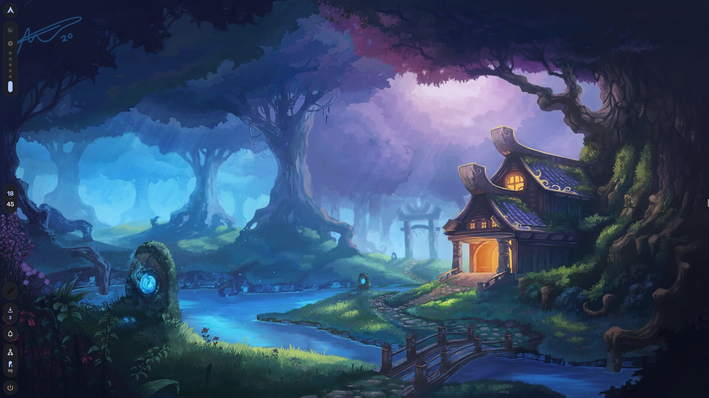
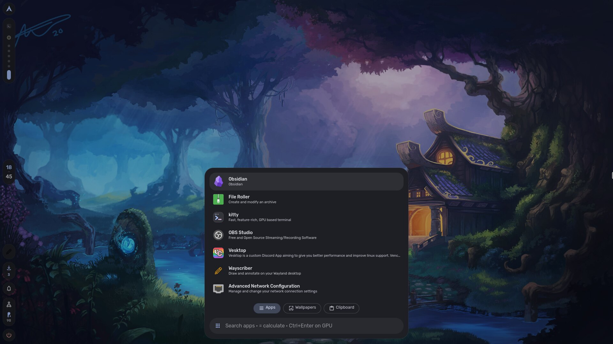
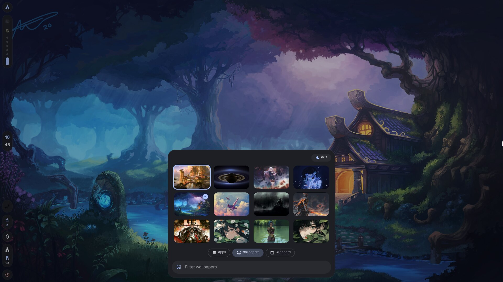
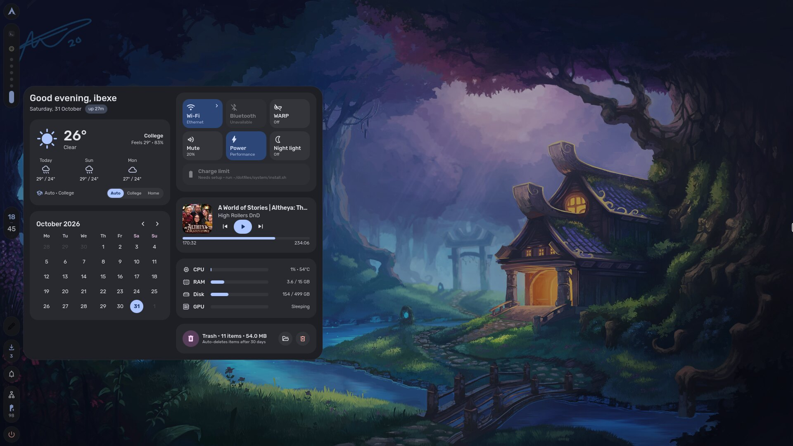
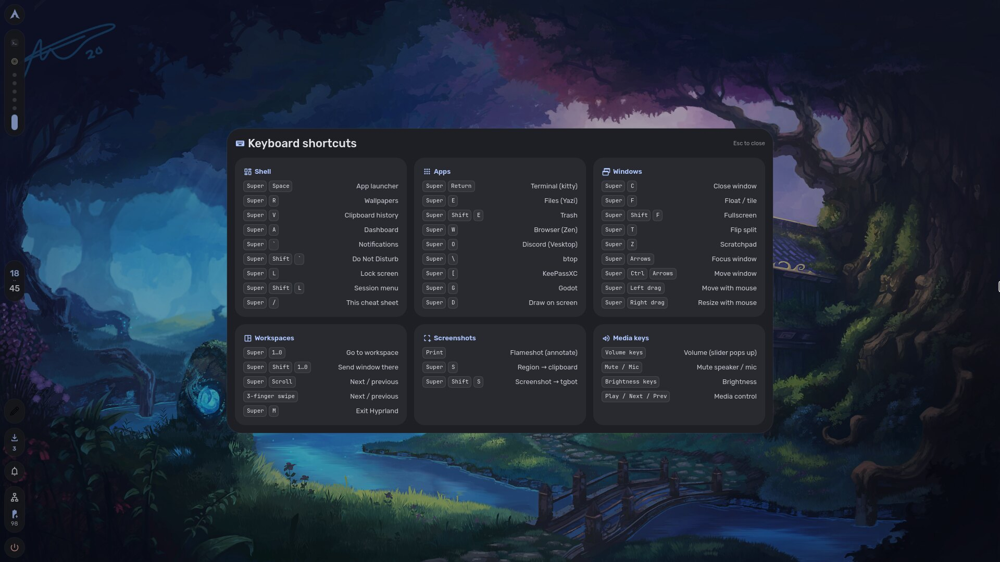
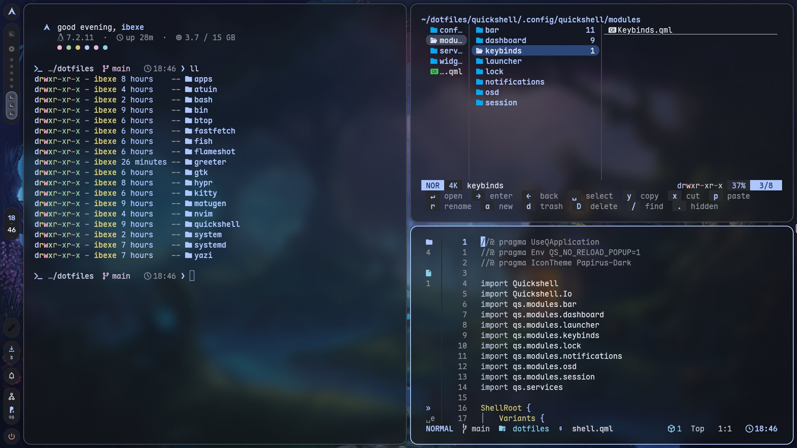

<div align="center">

# rice

**A soft, rounded Hyprland desktop whose colours come from the wallpaper.**
Floating islands on the left, a shell written from scratch in Quickshell, and every app recoloured
the moment you change the wallpaper.



</div>

---

## The desktop

The bar is a column of floating islands on the left edge: logo/launcher, workspaces that show the
apps open on each one, the clock, then tray, updates, notifications, status and power at the bottom.

| | |
|:-:|:-:|
|  |  |
| **Launcher** — apps by most used, `=` calculator, Ctrl+Enter opens on the NVIDIA GPU | **Wallpapers** — pick one and the whole rice recolours |
|  |  |
| **Dashboard** — weather, calendar, toggles, media, system stats, trash | **Super + /** — every shortcut on one sheet |



**Terminal** — kitty (glassy, Maple Mono), fish + starship, Yazi with a key-hint bar, and LazyVim
with a slim file-tree rail.

## Features

**Shell (Quickshell / QML, written from scratch)**
- Launcher with three tabs: apps, wallpapers, and clipboard history (with image previews)
- Notifications: popups, a history menu beside the bell, Do Not Disturb on left-click
- Dashboard: weather with College/Home places (auto-detected from the network), calendar,
  Wi-Fi / Bluetooth / WARP / mute / power profile / night light toggles, a Wi-Fi network page,
  media controls, CPU/RAM/disk/GPU, trash, and a 95 % battery charge limit
- Volume and brightness OSD, styled tray menus, session menu, lock screen
- Package update counter on the bar (repo + AUR), updates in a floating terminal
- Login screen: a greetd greeter built with the same shell, synced to the current wallpaper

**Colours from the wallpaper** ([matugen](https://github.com/InioX/matugen), Material You) —
one `rice-wall` call recolours the shell, Hyprland borders, kitty, fish/starship, btop, Yazi,
Neovim, lazygit, GTK 3/4, Qt, Vesktop, the lock screen and the login screen. Each Zen Browser
profile gets its own accent from the same palette, so profiles look related but distinct.

**Everything else** — Bibata cursor and Rubik UI font everywhere, Papirus icons, a trash that
empties itself after 30 days, sensible default apps.

## What's in here

Each folder is a [GNU Stow](https://www.gnu.org/software/stow/) package that mirrors `$HOME`.

| Package | What it is |
|---|---|
| `quickshell` | The shell: bar, launcher, notifications, dashboard, OSD, lock screen |
| `hypr` | Hyprland (Lua config), hypridle, hyprlock fallback |
| `matugen` | Colour templates for every app |
| `bin` | `rice-wall` (set wallpaper + recolour), `rice-zen`, `rice-trash`, `rice-defaults` |
| `kitty` `fish` `atuin` `bash` | Terminal, shell, history, login environment |
| `nvim` | LazyVim with the file-tree rail |
| `yazi` `btop` `fastfetch` `flameshot` `gtk` `apps` `systemd` | App configs, desktop entries, trash timer |
| `greeter` | Login screen (installed with `sudo greeter/install.sh`, not stowed) |
| `system` | Root bits: battery charge-limit permission (`sudo system/install.sh`) |

## Install

Arch Linux. Read before running — this is my setup, not an installer.

```sh
# repos
sudo pacman -S --needed hyprland quickshell matugen awww hypridle hyprlock hyprsunset \
  cliphist wl-clipboard wl-clip-persist brightnessctl playerctl grim slurp \
  kitty fish starship yazi neovim lazygit eza bat fzf zoxide atuin btop imv mpv \
  libqalculate ffmpeg imagemagick pacman-contrib libnotify stow \
  power-profiles-daemon networkmanager upower greetd \
  papirus-icon-theme adw-gtk-theme qt5ct qt6ct ttf-jetbrains-mono-nerd ttf-material-symbols-variable

# AUR
yay -S --needed ttf-rubik-vf maplemono-nf bibata-cursor-theme-bin
# optional: zen-browser-bin python-pywalfox vesktop-bin

git clone https://github.com/denzel-robin/dotfiles ~/dotfiles
cd ~/dotfiles
stow quickshell hypr matugen bin kitty fish atuin bash nvim yazi btop fastfetch flameshot gtk apps systemd

rice-wall ~/path/to/wallpaper.png     # generates every colour file
sudo ~/dotfiles/greeter/install.sh    # optional: the login screen
sudo ~/dotfiles/system/install.sh     # optional: battery charge limit (ASUS laptops)
```

Personal settings stay out of the repo, in local files:
`~/.local/state/rice/place.json` (weather places and the networks that mean "college"/"home")
and `~/.config/rice/zen-profiles.json` (accent per Zen profile).

## Keys

| Key | Action | Key | Action |
|---|---|---|---|
| `Super Space` | Launcher | `Super Return` | Terminal |
| `Super R` | Wallpapers | `Super E` | Files (Yazi) |
| `Super V` | Clipboard history | `Super Shift E` | Trash |
| `Super A` | Dashboard | `Super L` | Lock |
| ``Super ` `` | Notifications | `Super Shift L` | Session menu |
| `Super /` | All shortcuts | `Super 1–0` | Workspaces |

## Credits

Inspired by [Caelestia](https://github.com/caelestia-dots/shell).
